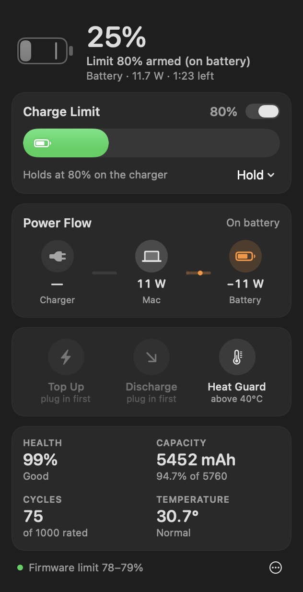

<p align="center">
  
</p>

<h1 align="center">BatteryHealth</h1>

A menu bar app that keeps an Apple silicon MacBook's battery at a charge limit, so it doesn't sit at 100% on the
charger. Built and tested on an **M4 MacBook Air** (`Mac16,13`, battery firmware `20457.1.29`, macOS 26.7.1).

The limit is enforced by the battery firmware itself, so it keeps working while the Mac sleeps or the app is closed.

<p align="center">
  
  &nbsp;&nbsp;
  
</p>

## Features

- **Charge limit, 70–100%.** By default it holds the battery at the limit while plugged in: charging stops the
  moment the menu bar shows the limit (e.g. exactly 80%), and the Mac then runs from the charger with the battery idle.
  Optionally let it drop 3, 5 or 10% below the limit before charging again.
- **Power Flow.** Live charger → Mac → battery watts. A charger only supplies what the Mac draws; its rating
  (e.g. 35 W) is a maximum.
- **MagSafe LED.** Green while held at the limit, orange while charging or discharging toward it.
- **Heat Guard.** Pauses charging while the battery is above 35, 38 or 40 °C.
- **Top Up.** Charge to 100% once, e.g. before a trip. The limit comes back when you unplug.
- **Discharge.** Run from the battery while plugged in until it's down to the limit. Idle sleep is blocked meanwhile,
  and the charger is always reconnected before sleep.
- **Health.** Maximum capacity as macOS reports it, plus the raw measured capacity, cycle count and temperature.

## Install

Needs the Xcode command line tools (Swift 5.9+) and macOS 14+.

```bash
scripts/build.sh release --install
```

This builds the app, copies it to `/Applications` and opens it. Click the icon in the menu bar → **Install Helper** and
enter your admin password once. That installs a small root service, which is the only part allowed to write to the
battery controller:

- `/Library/PrivilegedHelperTools/com.kaanusta.batteryhealth.daemon`
- `/Library/LaunchDaemons/com.kaanusta.batteryhealth.daemon.plist`
- settings: `/Library/Application Support/BatteryHealth/config.json`
- log: `/var/log/batteryhealthd.log`

**Turn off macOS's own charge limit** (System Settings → Battery → Charging → 100%). Both limits stop charging
independently, and with both on the battery ends up a few percent under the limit. The panel warns you when macOS's
limit is on.

To remove everything: **⋯ → Uninstall Helper…**, then delete the app.

## How it works

Charging is controlled through undocumented SMC keys, and Apple changes them with battery **firmware** updates, not
macOS versions. On firmware 20457 the older charge-control keys are gone:

| Key | Purpose | On this Mac |
| --- | --- | --- |
| `BCLM` | Max charge (Intel Macs) | no |
| `CH0B` / `CH0C` | Charge inhibit (older Apple silicon firmware) | no |
| `CHTE` | Charge inhibit (macOS 26 / 15 firmware) | removed in 20457 |
| `bfF0` / `bfD0` / `bfE0` | Firmware charge range: on/off, upper, lower | **yes** |
| `CHIE` | Disconnect the charger (forced discharge) | yes |
| `ACLC` | MagSafe LED colour | yes |

BatteryHealth picks the method from the keys that exist:

1. **Firmware range** (`bfF0`/`bfD0`/`bfE0`): the battery firmware stops charging inside the range on its own.
   Used on the M4.
2. **Charge inhibit** (`CHTE`, or `CH0B` + `CH0C`): the daemon switches charging on and off, and pauses it before
   sleep. Used on older firmware.
3. Neither: monitoring only.

`bfD0`/`bfE0` are little-endian `ui32` percentages, written in the order off → upper → lower → on. Thanks to
[batt](https://github.com/charlie0129/batt) for documenting them.

The firmware compares the range with the battery gauge's own state of charge, which runs 1–4 points below the
percentage macOS shows. To make the menu bar land exactly on the limit, the daemon fixes the range at the gauge value
the moment macOS shows the limit while charging. If the shown value later sits off the limit, it moves the target by
one point at most every 15 minutes, and only while the battery is idle. The target never goes more than 4 points below
the limit.

## Command line

The daemon binary doubles as a CLI. Settings changes go through the running daemon. With `sudo`, they also work when
the daemon isn't running.

```bash
B=/Applications/BatteryHealth.app/Contents/Resources/batteryhealthd
$B status            # battery, gauge, power flow, limiter state
$B set 80            # hold at 80%
$B gap 5             # charge again once 5% below the limit (1 = hold)
$B heat 38           # pause charging above 38 °C (heat off to disable)
$B topup             # 100% once
$B discharge         # run on battery down to the limit
$B led off           # leave the MagSafe LED to macOS
$B keys              # list charge-related SMC keys
sudo $B reset        # limiter off, everything back to stock
```

Without the app: `sudo scripts/install-daemon.sh` / `sudo scripts/uninstall-daemon.sh`.

## Notes

- **macOS's own limit** (macOS 26.4+) is a separate gate, and the lower of the two wins. macOS also charges to 100%
  every few weeks to recalibrate. The firmware range set here is independent of that.
- **Quitting the app doesn't remove the limit**, because it lives in the firmware. Use **⋯ → Restore Stock Charging**
  or `batteryhealthd reset` for that.
- On **macOS 27 beta 4+** firmware, Apple locks these keys behind a private entitlement, so even root gets
  `kIOReturnNotPrivileged`. If that reaches this Mac, the panel shows the write error.
- Writing to the SMC is undocumented. Use at your own risk.
