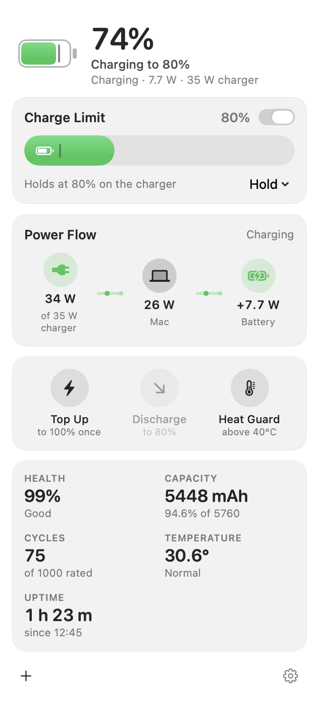

<p align="center">
  
</p>

<h1 align="center">BatteryHealth</h1>

<p align="center">Keeps your MacBook's battery at 80% (or any limit you pick) instead of 100%.</p>

## Install

**[Download BatteryHealth.dmg](https://github.com/KaanEkimoz/BatteryHealth/releases/latest/download/BatteryHealth.dmg)** · Apple silicon Mac, macOS 14+

Open the DMG, drag BatteryHealth to Applications, open it, then click the leaf in the menu bar → **Set Up…**

Also set macOS's own limit to 100% (System Settings → Battery → Charging) so the two don't fight.

<p align="center">
  
  &nbsp;&nbsp;
  
</p>

## Features

- **Charge limit, 70–100%.** Charging stops the moment the menu bar shows your limit, and the Mac then runs straight
  from the charger. Works while the Mac sleeps or the app is closed.
- **Power Flow.** Live watts from charger to Mac to battery.
- **Quick actions.** Top up to 100% once, discharge down to the limit, or pause charging when the battery is hot.
- **Stats.** Health, capacity, cycles, temperature, uptime and time left. Each one is its own tile.
- **MagSafe LED.** Green when held at the limit, orange while moving toward it.
- **Restart reminder.** A notification once the Mac has been on for 3 days.
- **Make it yours.** Hover a tile and click − to hide it, add it back with +, drag tiles to reorder.

To uninstall: ⚙ Settings → **Remove Charge Control…**, then delete the app.

## How it works

Apple changes the battery's control keys with firmware updates, which is why older charge limiters stopped working.
On current Apple silicon firmware BatteryHealth uses the battery's own charge range (`bfF0` / `bfD0` / `bfE0`), so the
firmware enforces the limit itself. Older Macs fall back to switching charging on and off (`CHTE`, `CH0B` / `CH0C`).

A small root service (`/Library/PrivilegedHelperTools/com.kaanusta.batteryhealth.daemon`) is the only part that
writes these keys. Thanks to [batt](https://github.com/charlie0129/batt) for documenting them.

<details>
<summary>Build from source and command line</summary>

Needs the Xcode command line tools (`xcode-select --install`).

```bash
scripts/build.sh release --install   # build, copy to /Applications and open
scripts/make-dmg.sh                  # build, sign and notarize the DMG
```

The service binary is also a CLI:

```bash
B=/Applications/BatteryHealth.app/Contents/Resources/batteryhealthd
$B status        # battery, power flow, limiter state
$B set 80        # hold at 80%
$B heat 38       # pause charging above 38 °C
sudo $B reset    # turn the limit off, back to stock macOS charging
```

Logs: `/var/log/batteryhealthd.log` · Settings: `/Library/Application Support/BatteryHealth/config.json`

</details>

## Notes

- Quitting the app doesn't remove the limit, because it lives in the firmware. Use ⚙ Settings → **Turn Off and Use macOS Charging**.
- Tested on an M4 MacBook Air (firmware 20457, macOS 26.7). Writing to the battery controller is undocumented; use at your own risk.
